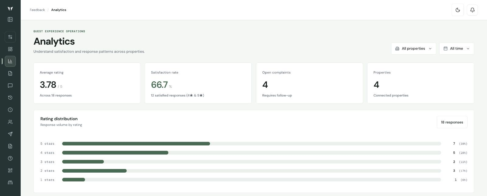
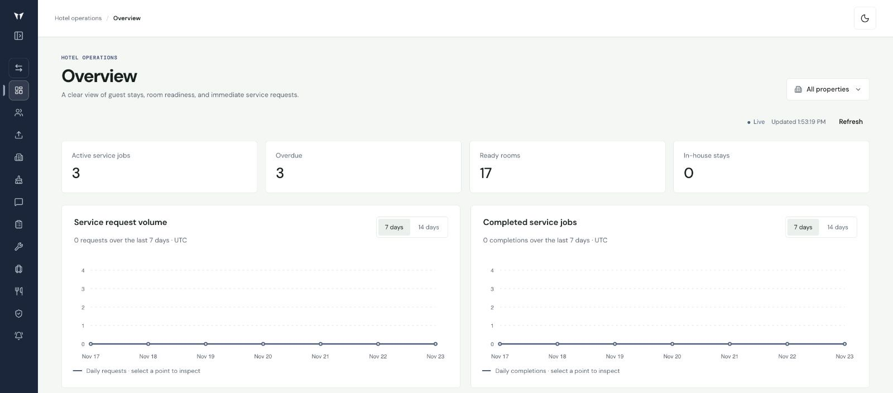

# Vistora

**Guest feedback and hotel operations in one workspace.**

Vistora helps hotel teams collect guest feedback, follow up on complaints, and coordinate day-to-day service across properties. Guests can respond through questionnaires, QR codes, and invitation links. Staff can review ratings, assign work, and track cases from intake to resolution.

[Screenshots](#screenshots) · [Local setup](#local-setup) · [Checks](#checks) · [Repository guide](#repository-guide)

## What teams can do

| Area | Workflows |
| --- | --- |
| Feedback | Build property-specific questionnaires, share surveys, review guest responses, and compare ratings and recurring topics across properties. |
| Service recovery | Prioritize follow-ups, assign owners, track response deadlines, and record resolutions. |
| Hotel operations | Track stays and room readiness, dispatch service jobs, manage housekeeping and inspections, and review alerts on mobile. |
| Guest imports | Preview and reconcile occupancy reports before applying changes to guest and stay records. |
| Administration | Manage workspaces, properties, team permissions, routing rules, integrations, and audit history. |

## Screenshots

### Feedback analytics

Filter by property and date to see satisfaction, rating distribution, and open complaints.



### Hotel operations

Monitor active service jobs, overdue work, ready rooms, and in-house stays.



### Workspace sign-in

Sign in to an existing workspace or start onboarding for a new one.


## Local setup

Vistora uses Next.js, React, and TypeScript. Supabase provides PostgreSQL, authentication, storage, and realtime updates.

**Prerequisites** · Node.js 20.9 or later, npm, and a Supabase project configured for email and password sign-in. Use a dedicated development project for a fresh setup.

1. Install dependencies from the repository root.

   ```sh
   npm ci
   ```

2. For a fresh development database, run [`supabase/schema.sql`](supabase/schema.sql) from the start through the `COMMIT;` at the end of section 27, immediately before the comment beginning `-- Apply after 20261103_granular_rights.sql`. This baseline includes development seed data. Then run these migrations in order using the Supabase SQL editor or `psql`.

   1. [OmniOps](supabase/migrations/20261029_omniops.sql)
   2. [Guest experience automation](supabase/migrations/20261030_guest_experience_automation.sql)
   3. [Feedback collection](supabase/migrations/20261103_feedback_collection.sql)
   4. [Granular rights](supabase/migrations/20261103_granular_rights.sql)
   5. [Guest report reconciliation](supabase/migrations/20261103_guest_report_reconciliation.sql)
   6. [Questionnaires and short links](supabase/migrations/20261103_questionnaires_and_short_links.sql)
   7. [Security boundaries](supabase/migrations/20261103_security_boundaries.sql)
   8. [Import and form synchronization](supabase/migrations/20261104_import_form_sync.sql)

   For an existing deployment, apply the pending migrations for its current schema version.

3. Create `.env.local` in the repository root. Fill in the Supabase project URL, anon key, and service-role key. Generate a stable encryption key with `openssl rand -hex 32`.

   ```dotenv
   NEXT_PUBLIC_SUPABASE_URL=
   NEXT_PUBLIC_SUPABASE_ANON_KEY=
   SUPABASE_SERVICE_ROLE_KEY=
   APP_URL=http://localhost:3000
   WORKSPACE_ENCRYPTION_KEY=
   ```

   Keep the service-role key and encryption key server-side. For automatic escalations and queued delivery, set a separate `WORKSPACE_CRON_SECRET` and schedule an authenticated `POST /api/jobs` every minute using that secret as the bearer token. For email delivery, configure `RESEND_API_KEY` and `MAIL_FROM` with a verified sender.

4. Start the development server.

   ```sh
   npm run dev
   ```

   Open [the workspace setup page](http://localhost:3000/start) to create an account. Confirm the account by email if required by your Supabase project, then sign in and create your workspace. Existing team members can [sign in](http://localhost:3000/login).

## Checks

| Command | Purpose |
| --- | --- |
| `npm test` | Run the default automated suite. |
| `npm run build` | Compile a production build. |
| `npm start` | Serve the production build locally after it compiles. |
| `npm run test:database` | Run workspace database tests with `psql` and `VISTORA_TEST_DATABASE_URL` set to a disposable database named `vistora_test`. |

## Repository guide

| Path | Contents |
| --- | --- |
| [`app/`](app/) | Public pages, authenticated workspace routes, and API handlers. |
| [`components/`](components/) | Feedback, hotel operations, and administration interfaces. |
| [`lib/`](lib/) | Authentication, permissions, workflow logic, and integrations. |
| [`supabase/`](supabase/) | Database schema, migrations, and the OmniOps scheduler function. |
| [`tests/`](tests/) | Automated application tests and database integration checks. |
